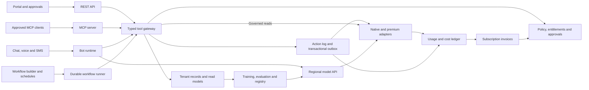

# Architecture

## System boundaries

Deploy a modular application and purpose-specific workers in AWS Canada (Central), `ca-central-1`. Browser clients, bots, customer workflows and Model Context Protocol (MCP) clients share one set of governed business tools. Keep sensitive data, business decisions and provider calls behind platform-controlled interfaces. [AWS regions](https://docs.aws.amazon.com/global-infrastructure/latest/regions/aws-regions.html)

### Tenancy and records

Use RDS PostgreSQL with one database and restricted role per launch tenant, capacity-managed in regional clusters. Keep only routing and minimal service metadata in the shared control plane. Derive tenant, actor and grants from verified identity and server-resolved bindings. Scope queues, caches, jobs, objects, model artifacts, checkpoints and retrieval by tenant. Encrypt with KMS, test isolated backup and restore, and automate provisioning before expanding density.

Set one authoritative provider per entity and record class. Native ERP owns operational orders, procurement and stock when selected. Native CRM can own companies, contacts and pipeline while QuickBooks or another customer ledger owns posted invoices, payments, balances and tax records. Support imported snapshots for authorized reads. Carry source ID, currency, event and update times, version and freshness on every record. Use stable ID mappings and a reconciled accounting export or one-way handoff. On provider change, import and compare in shadow, freeze writes for the affected capability, reconcile open effects and cut over with an explicit rollback plan.

## Execution and failure handling

1. Publish versioned JSON Schema for tools and events. Each tool declares inputs and outputs, scopes, record-level permissions, risk class, material fields, approval behavior and idempotency scope. Carry tenant, actor, source, trace and correlation IDs across calls. Use bounded action counts and time budgets. Treat retrieved documents, email and tool responses as untrusted input and keep credentials and arbitrary network access outside runtimes.
2. Check entitlements, actor permissions, tenant policy, consent, freshness and spend before accepting work and again before each effect. Bind an approval to exact material inputs, source references, approver, policy version and expiry. Invalidate approval when a bound value changes. Return structured pending, denied, failed or unknown states.
3. Persist intent, append-only audit and a transactional outbox with the same commit. A worker dispatches the committed action using the same tenant-scoped idempotency key across retries and passes it upstream when supported. Reconcile upstream effect IDs before retrying an ambiguous send or write. Route unresolved outcomes to review. Reverse eligible writes through traceable compensating actions.
4. Pin published workflow definitions and execution state to a version. Use a constrained node catalog for schedules, events, conditions, mappings, delays, approvals and typed actions. Support side-effect-free preview, retries with backoff, dead-letter review, safe replay and per-tenant quotas. Changes to permissions and suppression apply even to an already running workflow.
5. Expose REST and authenticated streamable HTTP MCP from the same catalog. Use scoped REST/OAuth clients, validate MCP token audience and tenant membership and block upstream use of inbound access tokens. Prefer customer OAuth for connectors. Sign and deduplicate webhooks, reconcile at checkpoints and use deterministic imports. Treat partner MCP servers as allowlisted providers with explicit scope and data-flow review. [MCP authorization specification](https://modelcontextprotocol.io/specification/2025-11-25/basic/authorization)

For outbound collection calls and SMS, route each contact through a channel-specific release flag and the shared dispatch gateway. Recheck current balance, consent, identity, local contact window, counts across channels and suppressions before dispatch. Record provider receipts and outcomes against the same contact history as email. Use bounded scripts and verified replies, with tenant and platform kill switches for queued work and active calls. Native, BYO and fallback providers use the same controls. [Outbound compliance gate](05-governance-security-compliance.md#outbound-voice-and-sms-collections-gate)

## Bot runtime decision

Use self-hosted Python LangGraph for bot decision loops. The delivery lead implements the run, stream, interrupt and resume contract in January. The founder approves the shared interface and reviews voice latency, handoff and restart evidence at integration gates. Keep fast audio transport and interruption handling in the voice edge. Run long-lived customer automations in Temporal with a deterministic interpreter for published definitions. Version graphs, isolate checkpoints by tenant and test replay. A pending LangGraph interrupt can display approval state while the gateway remains the authority for approval and external effects. Resuming may re-execute part of a node. [LangGraph persistence](https://docs.langchain.com/oss/python/langgraph/persistence) · [LangGraph interrupts](https://docs.langchain.com/oss/python/langgraph/interrupts)

## Technology decisions

| Area | Planning default |
| --- | --- |
| Portal and API | React/Next.js and TypeScript, Fastify API and JSON Schema/OpenAPI. Use React Flow for the workflow editor. Generate types for Python workers from the shared specification. |
| Infrastructure and workflow | ECS/Fargate, RDS PostgreSQL, S3, SQS for ingress/dispatch, KMS, Secrets Manager, Terraform and OpenTelemetry to regional log and metric sinks. Run Temporal in Canada with PostgreSQL persistence. |
| Identity and access | Platform-managed OIDC with Keycloak and staff MFA. The application owns membership, role grants and approvals. Add customer OIDC/SAML federation through a tenant identity adapter. |
| Native ERP and CRM | Purpose-built TypeScript modules in PostgreSQL. Use inventory movements, order and purchase lifecycles, and CSV/JSON exports. Maintain shared contact identity and stable links between sales, procurement and fulfilment. |
| Language, voice and ML | Native model API backed by vLLM on regional GPU instances. Start with a licence-reviewed open-weight instruct model. Use PostgreSQL/pgvector for scoped retrieval, regional embeddings, Python jobs for scoring and training, S3 artifacts and a regional MLflow registry. Use Asterisk/SIP and WebRTC, regional speech-to-text and text-to-speech workers, and a browser-based contact centre queue. |
| Subscription and delivery | Build the SKU, entitlements, allowance and invoice ledgers in-platform. Default to Stripe Billing for invoice delivery and settlement. Use domain-verified, platform-managed email via Amazon SES in Canada Central, subject to production access and terms. Keep client merchant accounts and platform settlement separate. [SES regional endpoints](https://docs.aws.amazon.com/general/latest/gr/ses.html) |

## Provider abstraction

Each sellable capability has a platform-run native adapter and a contract for approved alternatives. Infrastructure uses regional defaults and can bind approved managed services or a dedicated regional deployment through a platform-operator configuration. Tenant admins choose supported alternatives per capability. The platform preserves policy, evidence and entitlements across selections.

| Capability interfaces | Native service and upgrade surface |
| --- | --- |
| Chat, contact centre, telephony, speech | Native chat widget, agent queue, handoff and SIP/WebRTC stack with contracted carrier access and hosted speech. Swap telephony/contact centre independently of speech, for example RingCentral RingCX and ElevenLabs. |
| Language models, embeddings and retrieval | Native platform API with authenticated streaming, structured output and tool proposals, plus regional embeddings and retrieval. Route to hosted open weights or a permitted provider behind the same API. Accept customer-held OpenAI or Anthropic keys subject to route approval. |
| Business records and communications | Native ERP/CRM, managed import/export, platform-managed verified-domain email and connector catalog. Swap record classes to supported incumbent systems and mail to the customer's managed mailbox or sending account. For gated outbound collections, provide platform-managed SIP and SMS carriage with approved customer-held alternatives. |
| Bots, workflows and decision support | Native bot runtime, workflow runner, fraud rules, statistical forecasts and grounded profiles. Tenant-qualified models and profiling trainers use the same interfaces. Provide scoped interfaces for approved external runtime, workflow execution, scoring, training and inference. Callbacks and resulting actions return to platform policy. |
| Platform services | Native identity and membership, policy evaluation, storage, event delivery, telemetry, audit, metering and subscription services. Support external identity and policy checks, region-bound storage or event destinations, observability and audit sinks, and billing/invoice connectors. The gateway still enforces platform restrictions and records approval and action evidence. Telecom carriage, hosting and payment settlement use contracted infrastructure. |

**Configuration and secrets.** Store a versioned tenant binding per capability with provider and adapter versions, account and secret references, supported features, allowed data classes, quotas and fallback preferences. Resolve the binding from the authenticated tenant and pin it to the action. Verify account identity and OAuth grants before activation. Encrypt secrets per tenant, grant only the adapter access, and support rotation and revocation.

**Residency and feature checks.** Declare flags for processing, storage, backups, logs, support, training use and retention, along with supported region and data classes. Deny a route with unknown or incompatible terms. Check flags for each call, fallback, evaluation, webhook and support path. Surface capability gaps during setup.

**Metering and fallback.** Record provider request and outcome IDs, units, region, provider/account reference, price version and charge mode. Fallback for reads or inference is opt-in and must satisfy the same tenant, region, data class, quality and cost policy. Freeze external writes or messages with an unknown outcome. Reconcile first and use an explicitly approved recovery action. Use human handoff, held work or a local baseline when no suitable fallback is configured. [Metering and pricing](06-pricing-packaging.md#metering-and-invoice-controls)

**Provider research** covers [voice and telephony](providers/voice-telephony.md), [LLM models](providers/llm-models.md), [business systems](providers/business-systems.md), [ML and data](providers/ml-data.md) and [platform infrastructure](providers/platform-infra.md).

## Licensing and partner checks

Maintain a component, model and data licence inventory with exact versions, notices, obligations and approved deployment modes. Verify open-weight redistribution, serving, fine-tuning and attribution rights per release. Keep proprietary platform logic separate from third-party ERP adapters. Odoo Community uses LGPLv3. Keep its notices and review each OCA or third-party add-on, dependency, branding and distribution duty separately. Use separately authorized Enterprise subscriptions where required. Review GPLv3 conditions for ERPNext distribution and any AGPL network-source obligations for the selected use. Require written embedding and resale rights for a third-party workflow engine under commercial terms such as n8n. Review OAuth scopes, API terms, training and retention for each connector. [Odoo Community licence](https://github.com/odoo/odoo/blob/19.0/LICENSE) · [Odoo licence terms](https://www.odoo.com/documentation/19.0/legal/licenses.html) · [ERPNext licence](https://github.com/frappe/erpnext/blob/develop/license.txt) · [n8n licence](https://github.com/n8n-io/n8n/blob/master/LICENSE.md)

[Overview](00-overview.md) · [Modules](02-modules.md) · [Roadmap](03-roadmap.md) · [Governance](05-governance-security-compliance.md)
