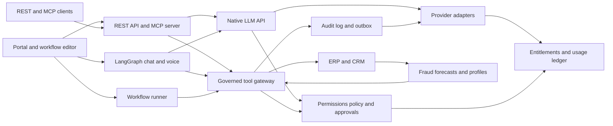

# Architecture

Use one monorepo and a modular application with a background worker. Start in Docker Compose on personal equipment. Keep one fictional distributor for the demo and seed a second fictional workspace for isolation tests. Give each record, job and provider binding a workspace ID resolved from the caller's identity.

## Stack and deployment

| Area | Choice |
| --- | --- |
| Portal and API | React with Vite and TypeScript, React Flow for the editor, and Fastify with JSON Schema and OpenAPI. Serve the built portal from the same app. Expose native REST and authenticated Streamable HTTP MCP through one typed tool catalog. Use an official MCP SDK and scoped OAuth for remote MCP access. |
| Identity and storage | PostgreSQL for business records, workflow state, checkpoints, the audit log, jobs and metering. Use a small self-hosted OIDC provider such as Dex with demo-only accounts. Map verified subjects to application roles and use scoped service identities for bots and workers. Keep separate schemas and database roles where they protect ownership. |
| Native ERP and CRM | Build small TypeScript modules in the same app. Own companies, contacts, deals, sales orders, stock movements, requisitions and POs in PostgreSQL. Use seeded receivables or a read-only accounting import for balances and export CSV for handoff. A lightweight custom core fits the demo because it shares identity, permissions and persistence with the rest of the app. Keep Odoo Community and ERPNext as adapter targets if broader accounting or inventory functionality is needed. |
| Bots and workflows | Python worker with self-hosted LangGraph and PostgreSQL checkpoints for chat and voice. Use React Flow to edit versioned graphs and a PostgreSQL-backed job runner for schedules, delays and retries. Share typed tools with LangGraph, with voice audio and interruption handling at the browser voice edge. |
| AI and voice | Use `llama.cpp` with a small, licence-reviewed quantized instruct model for local native inference. Use browser audio, `whisper.cpp` and a licence-reviewed Piper voice for the local speech path. Keep deterministic fixture adapters for CI and for demos when a model or audio process is off. Use Mailpit for local email and simulated delivery for calls and SMS. |
| ML | Use Python and scikit-learn for fraud and forecasting, and PyTorch with PEFT/LoRA for a small profiling fine-tune. Keep versioned datasets, metrics and artifact manifests in a local volume and the registry metadata in PostgreSQL. Train on the school cluster or personal equipment and publish only small approved artifacts to the demo. |
| Cloud | Run the same Compose stack on one small private AWS Lightsail Linux VM in Canada Central (`ca-central-1`), with Caddy for TLS and access restricted to the owner. Choose the smallest size that passes a measured demo run. Prefer free local tooling and eligible trial credits. Run speech on demand and use fixture playback for repeatable cloud demos. Back up PostgreSQL and artifacts to encrypted regional snapshots and test a restore. [Lightsail regions](https://docs.aws.amazon.com/lightsail/latest/userguide/understanding-regions-and-availability-zones-in-amazon-lightsail.html) |

## GPU compute

- Use the A100 (40 or 80 GB, bf16, FlashAttention 2) for LoRA/QLoRA profiling fine-tunes, serving 7B–32B open-weight models with vLLM (larger with quantisation), and ML training as needed. Use the V100 (16 or 32 GB) for evaluations, batch inference, smaller models, embeddings and fraud or forecast experiments. Use fp16 on the V100, which lacks bf16 and FlashAttention 2. Keep most fraud and forecast work on CPU.
- Train and evaluate on the school cluster, likely under SLURM with Apptainer or Singularity containers. Copy versioned LoRA adapters and model manifests back to the project artifact registry. Keep job scripts reproducible, pin container and package versions, checkpoint to persistent storage for preemption, and transfer approved datasets and outputs through the school's approved channel with checksums.
- Back the always-on native LLM API for the private Canadian demo with a small quantised model on the demo VM's CPU or an on-demand rented GPU. School GPUs are typically queue-based and usually cannot host a public endpoint. Use the native/BYO provider abstraction to keep the demo working when school compute is unavailable.

## Gateway and provider routing

- Define typed tools once. REST, MCP, bots, workflows and the portal call the same service. Check workspace, actor, record access, entitlement and policy before accepting an action and again before executing it. Bind approval to exact inputs, source version, approver and expiry. Record decisions and outcomes in a redacted append-only audit log.
- Write intent, audit and the outbox job in one transaction. Use a stable action ID when retrying. Hold an unclear send or external write for reconciliation before trying again. Give each imported record one authoritative source and keep its source ID, version and freshness.
- Keep separate adapter interfaces for LLM inference, speech-to-text, text-to-speech, contact centre and telephony, messaging, and business systems. Default to the native options above. Add opt-in BYO adapters for OpenAI or Anthropic inference, ElevenLabs speech, RingCentral RingCX contact centre and carrier or accounting sandboxes as needed. Start with a real sandbox adapter where test credentials exist and use contract fixtures for the rest.
- Store a versioned provider binding per workspace and capability with an adapter version, secret reference, supported features, approved endpoints, allowed data, quota and routing limits. Keep test credentials in the adapter process. Check permissions and entitlements on the native LLM API and pin the binding for each action or model request. Stream responses and return structured output on supported routes. Send proposed tool calls through the gateway.
- Reserve usage before making a metered provider call. Log provider attempts and units such as tokens, audio seconds and messages. Deduplicate module usage by outcome ID and show it beside the module's allowance. Permit fallback for reads or inference only when explicitly configured within the same data and spend limits. [Spend controls](safety-notes.md)

See the [overview](README.md), [roadmap](roadmap.md), [module scopes](modules.md) and [agent workflow](dev-workflow.md).

Research behind these choices covers [master architecture](../master-plan/01-architecture.md), [platform infrastructure](../master-plan/providers/platform-infra.md), [business systems](../master-plan/providers/business-systems.md), [LLM models](../master-plan/providers/llm-models.md) and [voice and telephony](../master-plan/providers/voice-telephony.md).
